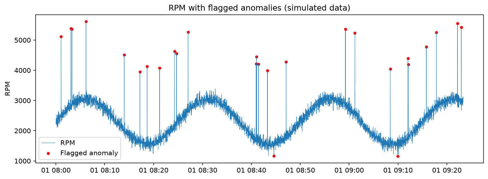
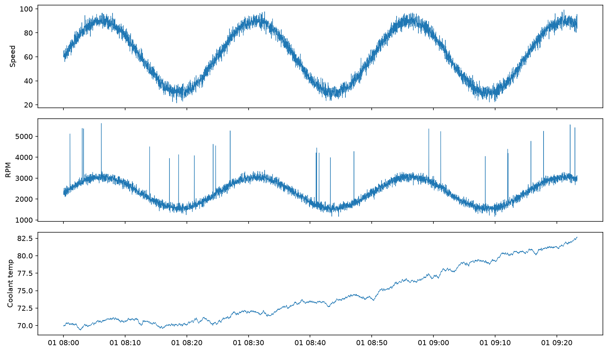

# Vehicle Signal Anomaly Detection (Simulated Data)

Python and SQL analysis of simulated vehicle sensor signals (speed, RPM, coolant temperature), with rule-based anomaly detection.

## Important note
The data in this project is SIMULATED with Python code. It is not real vehicle data. I added 25 RPM spikes (+2,500 RPM) on purpose so I could test whether my detection method finds them.

## Question
Can a simple rolling Z-score method find abnormal RPM readings in a time series, and how does the choice of threshold change the results?

## Tools
Python (Pandas, NumPy, Matplotlib), SQL (SQLite), Jupyter Notebook

## What I did
- Generated 5,000 one-second readings of speed, RPM and coolant temperature.
- Calculated a rolling mean and standard deviation of RPM over the previous 60 seconds.
- Computed a Z-score for each reading and flagged it as an anomaly when the absolute Z-score was above a threshold. I tested thresholds 3, 4, 5 and 6 and used 4 for the final chart.
- Compared the flags with the 25 injected spikes to count caught spikes, missed spikes and false alarms.
- Stored the data in SQLite and wrote a per-minute SQL summary (average and maximum speed and RPM, and anomaly count).

## Key findings
- With threshold 3, the method found all 25 injected spikes but raised 30 false alarms (about 45% of its 55 alarms were real).
- With threshold 4, it found all 25 spikes with 2 false alarms (about 93% of 27 alarms were real). I chose this as the best balance.
- With thresholds 5 and 6, there were 0 false alarms but one injected spike was missed (24 of 25 caught).
- The false alarms at threshold 3 had Z-scores of only about 3.0 to 3.8, while the injected spikes were much larger.
- I picked the threshold using data where the true anomalies were known. On real data this choice would depend on how costly a false alarm is compared with a missed problem.

## Charts

## Limitations
- The data is simulated and the injected spikes are very large, so finding them is easy. Results on real vehicle data would be harder to get.
- The method only looks at RPM and uses a simple statistical rule. It does not use machine learning.
- I did not test other kinds of anomalies, such as slow drift or sensor dropouts.
- The speed and RPM relationship in the data was written by me in code, so it only resembles real driving.

## Files
- notebooks/ : analysis notebook
- sql/analysis.sql : per-minute summary query
- images/ : charts